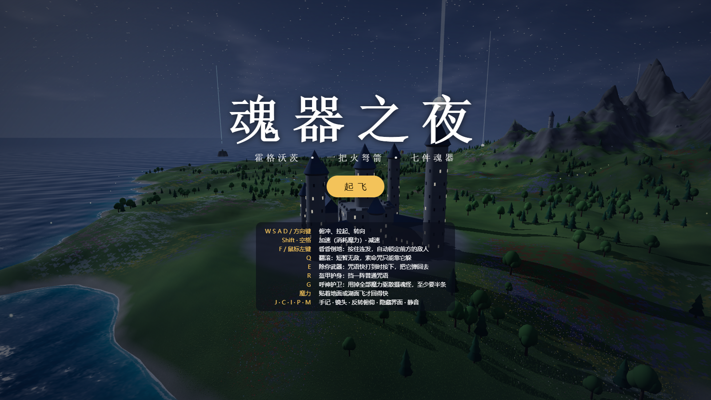
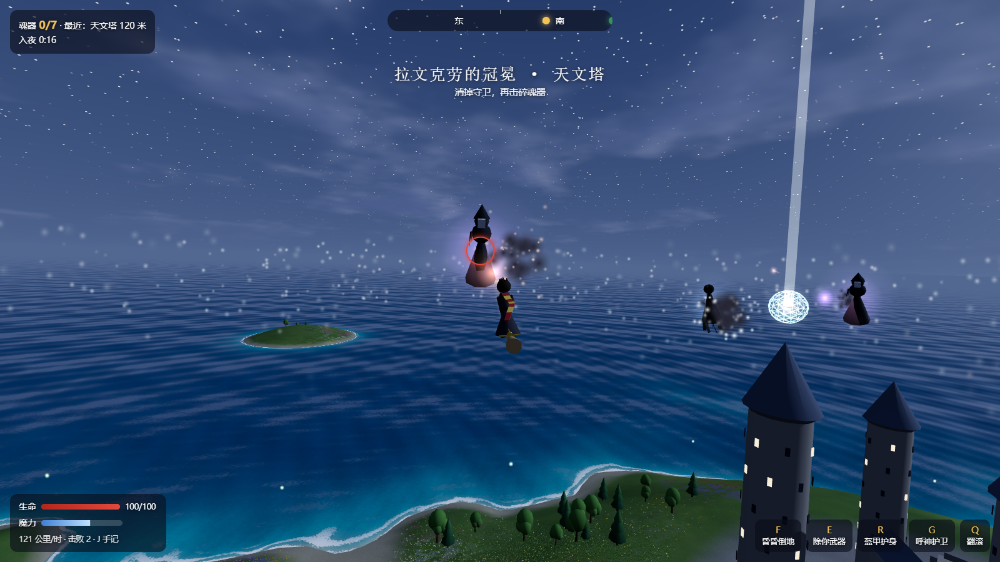

# 魂器之夜

_霍格沃茨，一把火弩箭，七件魂器。_

一个在浏览器里玩的扫帚空战肉鸽：骑着火弩箭在月夜的霍格沃茨场地上低空快飞，清掉守卫、毁掉魂器、挑一样强化，最后去找伏地魔。
一切都由代码在运行时生成：没有模型、贴图或音频文件，仓库里除了 three.js 之外只有源码。




**在线玩：<https://hxx344.github.io/huaxinfeng/>**

这个仓库原先是飞行小游戏《花信风》，2.0 起整体改成了现在这个游戏；地形、花田、海面和尾流沿用了原来的实现，所以仓库名和文件名没有改。

## 一局怎么玩

- **七件魂器**：六件在场地上（环石阵、尖叫棚屋、峡湾尽头、云顶、天文塔、禁林深处），金色光柱立在它们上方，罗盘上的金点指着最近的一件。第七件是你的伤疤。
- **守卫**：靠近一件魂器会惊动它的守卫，守卫没清完之前魂器被黑魔法护着，打不动。毁掉的魂器越多，后面的守卫越多。
- **强化**：每毁掉一件魂器，从三样强化里挑一样带走（连珠咒、分裂咒、霹雳爆炸、凤凰眼泪等 15 种）。
- **伏地魔**：绿色光柱下是他，随时可以去找他，但场地上的魂器剩得越多，他的血越厚、出手越快。他分三段：索命咒只能翻滚躲开；血量过半召来食死徒和摄魂怪；最后是闪回咒，两道咒语顶在一起，把他压在准星里按住施咒才能顶回去。第一次被索命咒打中不会死，它毁掉的是伤疤里的那片灵魂。
- **魔力**：施咒、加速、护盾和守护神都烧魔力。贴着地面或湖面飞，魔力回得快；场地上的光点接住一颗也补一截。
- 一局结束于被击落或击败伏地魔。战绩（局数、胜场、最多毁掉几件、最快通关）存在浏览器的 localStorage 里。

### 敌人

| 敌人 | 特点 |
| --- | --- |
| 摄魂怪 | 靠近时吸走魔力，贴身时吸走生命。昏迷咒锁不住它，只有呼神护卫能驱散 |
| 食死徒 | 咬在你身后开火，隔一阵抢到前面拦截，那几秒才打得到；也可以用除你武器把咒语弹回去 |
| 八眼巨蛛 | 在禁林地面上吐丝，被网住会一时提不起速度 |
| 匈牙利树蜂 | 守着金杯，正面的鳞甲让伤害减半，要绕到侧后方打 |

## 运行

**离线玩最简单的方式：** 下载 [`huaxinfeng.html`](huaxinfeng.html) 这一个文件，双击用浏览器打开就能玩。
页面、游戏代码和 three.js 都打包在里面，不需要服务器，也不需要其他文件。

改了源码之后，用 `npm install` 装一次打包工具，再用 `npm run build` 重新生成这个文件。

开发时也可以不打包，页面直接加载 `src/` 里的 ES 模块，这种方式需要一个静态文件服务器：

```
node tools/serve.mjs
```

然后打开 <http://localhost:6281>。需要支持 WebGL2 的浏览器（在 Chrome 中开发和验证）。`npm test` 跑规则和操纵换算的单元测试。

网址参数：`?q=low|medium|high` 调整花草密度，`?dpr=1.5` 指定像素比，`?noscale` 关闭自动降分辨率，`?noaa` 关闭抗锯齿，`?play` 跳过标题画面，`?touch` 在桌面上预览触屏界面。

## 操作

| 按键 | 作用 |
| --- | --- |
| `W` `S` 或 `↑` `↓` | 俯冲、拉起 |
| `A` `D` 或 `←` `→` | 侧倾转向 |
| `Shift` / `空格` | 加速（消耗魔力）/ 减速 |
| `F` 或鼠标左键 | 昏昏倒地：按住连发，自动锁定前方锥形范围里的敌人；飞行方向就是瞄准方向 |
| `Q` | 翻滚：短暂无敌，按着方向会顺势横移。索命咒只能靠它躲 |
| `E` | 除你武器：咒语快打到时按下，把它弹回给施咒的人 |
| `R` | 盔甲护身：挡一阵普通咒语，消耗两成魔力 |
| `G` | 呼神护卫：用掉全部魔力驱散摄魂怪，至少要半条 |
| `1` `2` `3` | 挑强化 |
| `J` | 手记：魂器的位置和已有的强化 |
| 鼠标 | 点击画面后用鼠标操纵，右键减速 |
| `C` `I` `P` `M` | 切换镜头、反转俯仰、隐藏界面、静音 |
| 手柄 | 左摇杆操纵，X 施咒，右扳机或 A 加速，左扳机或 B 减速，Y 守护神，LB 缴械，RB 翻滚，按下右摇杆护盾 |

**手机**：横屏打开，点“起飞”后倾斜手机来操纵（左右转向，前后俯冲和拉起），点“校准”把现在的拿法设为平飞。
没有重力感应或没给权限时，按住左半屏拖动就是摇杆。施咒、加速、减速、翻滚、缴械、护盾、守护神都有按钮。
重力感应需要 HTTPS（在线地址可以）；直接打开本地的 `huaxinfeng.html` 时部分浏览器不提供感应数据，会自动改用摇杆。

## 实现

原生 JavaScript 加 [three.js](https://threejs.org) r187，大部分画面用自写着色器。

- **战斗**（`src/game/combat.js`、`src/game/bolts.js`）：一局里的全部状态都在这里：生命和咒语冷却、锁定、所有飞行中的咒语（玩家的、敌人的、被弹回去的）、魂器的守卫、守护神和结算。
- **规则**（`src/game/rules.js`）：强化表、属性换算、守卫编制、伏地魔强度、锁定和预瞄的几何，都不依赖渲染，由 `tests/rules.test.mjs` 覆盖。
- **敌人与伏地魔**（`src/game/enemies.js`、`src/game/boss.js`）：四种敌人各有一套追击方式；伏地魔会化成黑烟在你前方重新现身，三个阶段按血量切换。
- **霍格沃茨**（`src/world/hogwarts.js`、`src/world/horcruxes.js`、`src/core/kit.js`）：城堡、霍格莫德、尖叫棚屋、魁地奇球场、海格小屋、猫头鹰棚屋、打人柳和礁石上的残塔都用盒子、圆柱和棱锥在代码里拼出来，合并成网格；选址时把地面整平。
- **哈利**（`src/player/rider.js`）：袍子、围巾、眼镜和火弩箭同样是拼出来的。
- **尾流**（`src/fx/wake.js`）：扫帚身后留下一串横截面，每个截面是一对反向旋转的涡核。花瓣和水花按最近的截面取诱导速度；草被压倒、海面起白沫；跟进尾流里的摄魂怪会被守护神一并驱散。
- **场地**（`src/world/terrain.js`、`src/world/meadow.js`、`src/world/water.js`、`src/world/sky.js`）：3.2 公里见方的高度场由噪声生成；草和花是围绕镜头平铺的实例；海面是叠加波的法线加菲涅尔反射；天空是月夜的渐变、星星和噪声云。
- **飞行与镜头**（`src/player`）：为贴地飞调的街机手感；镜头慢时贴近、冲刺时拉远。
- **声音**（`src/audio/audio.js`）：风声、海声、小调的背景音乐和所有咒语音效全部用 Web Audio 合成。

## 许可

three.js 以 MIT 许可内置于 `vendor/three`，见其中的 `LICENSE`。
本项目是非官方的同人作品，与《哈利·波特》的版权方没有关联。
