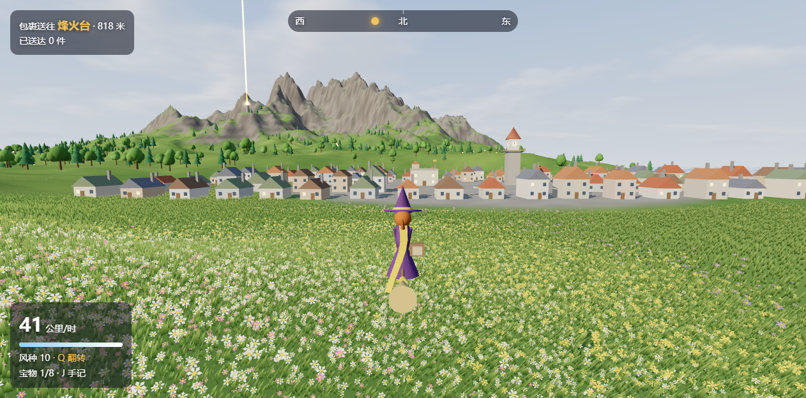
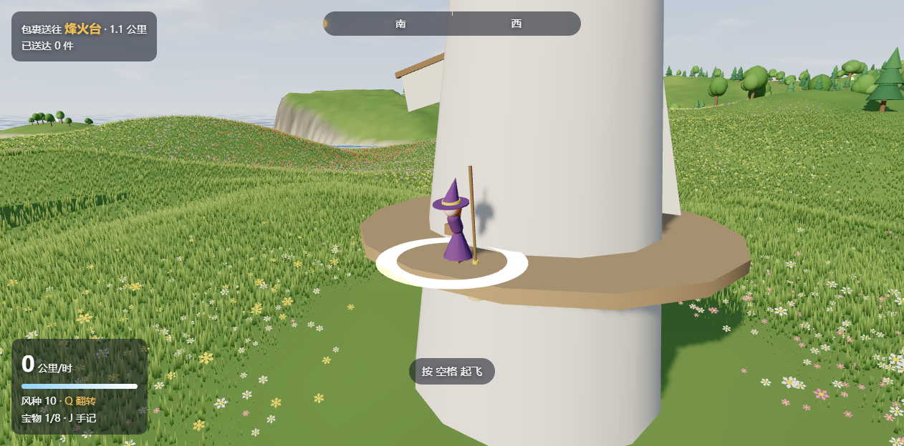

# 花信风

_一把扫帚，一座岛，一阵好风。_

一个在浏览器里玩的扫帚飞行小游戏：贴着花田、海崖和海面低空快飞，看身后的空气做了什么。
玩法参考了 [Petalwake](https://github.com/jjcm/petalwake)，但这里的一切都由代码在运行时生成：
没有模型、贴图或音频文件，仓库里除了 three.js 之外只有源码。




**在线玩：<https://hxx344.github.io/huaxinfeng/>**

## 运行

**离线玩最简单的方式：** 下载 [`huaxinfeng.html`](huaxinfeng.html) 这一个文件，双击用浏览器打开就能玩。
页面、游戏代码和 three.js 都打包在里面，不需要服务器，也不需要其他文件。

改了源码之后，用 `npm install` 装一次打包工具，再用 `npm run build` 重新生成这个文件。

开发时也可以不打包，页面直接加载 `src/` 里的 ES 模块，这种方式需要一个静态文件服务器：

```
node tools/serve.mjs
```

然后打开 <http://localhost:6281>。需要支持 WebGL2 的桌面浏览器（在 Chrome 中开发和验证）。

网址参数：`?q=low|medium|high` 调整花草密度，`?dpr=1.5` 指定像素比，`?noscale` 关闭自动降分辨率，`?play` 跳过标题画面。

## 操作

| 按键 | 作用 |
| --- | --- |
| `W` `S` 或 `↑` `↓` | 俯冲、拉起 |
| `A` `D` 或 `←` `→` | 侧倾转向 |
| `Shift` | 乘阵风加速 |
| `空格` | 减速 |
| `空格` `空格` | 靠近亮起的平台时降落；再按 `空格` 起飞 |
| `Q` | 翻转（接住十颗风种之后） |
| `J` | 宝物手记 |
| 鼠标 | 点击画面后用鼠标操纵，左键加速，右键减速 |
| `C` `I` `P` `M` | 切换镜头、反转俯仰、隐藏界面、静音 |
| 手柄 | 左摇杆操纵，右扳机或 A 加速，左扳机或 B 减速 |

**手机**：横屏打开，点“起飞”后倾斜手机来操纵（左右转向，前后俯冲和拉起），点“校准”把现在的拿法设为平飞。
没有重力感应或没给权限时，按住左半屏拖动就是摇杆。加速、减速、降落、翻转都有按钮。
重力感应需要 HTTPS（在线地址可以）；直接打开本地的 `huaxinfeng.html` 时部分浏览器不提供感应数据，会自动改用摇杆。
桌面浏览器加 `?touch` 可以预览触屏界面。

不会失败：俯冲会自己拉平并弹一下，墙会把你推开，飞得太远风会把你转回岛的方向。

- **包裹**：手上永远有一件包裹。金色光柱立在目的地上方，罗盘上的金点指着方向。岛上有 11 处可以降落的平台。
- **风种**：发光的小球沿着海岸、花田和峡湾排开，接住一颗补一截阵风。
- **宝物**：八个藏起来的地方各有一件，手记里有线索。
- 进度存在浏览器的 localStorage 里。

## 实现

原生 JavaScript 加 [three.js](https://threejs.org) r187，大部分画面用自写着色器。

- **尾流**（`src/fx/wake.js`）：扫帚身后留下一串横截面，每个截面是一对反向旋转的涡核，随时间下沉、变粗、变弱。花瓣和水花在 CPU 上按最近的截面取诱导速度，所以会被卷起来。
- **尾流的痕迹**：同一条轨迹以 uniform 数组传给草、花和海面的着色器（草被压倒、海面起白沫），并画进一张全岛的“掉瓣图”，飞得越低越快，那一处的花掉的瓣越多。
- **花田**（`src/world/meadow.js`）：草和花是围绕镜头平铺的实例，在顶点着色器里采样高度图落到地面上；花按名次随距离变稀，花瓣一片一片地掉。
- **岛**（`src/world/terrain.js`）：3.2 公里见方的高度场，由噪声生成：南岸缓滩、北岸陡崖、山、峡湾、海蚀柱和两座离岛。
- **城镇**（`src/world/town.js`、`src/core/kit.js`）：房子、塔、风车、灯塔都用盒子、圆柱和棱柱在代码里拼出来，合并成一个网格；选址时把地面整平。
- **海与天**（`src/world/water.js`、`src/world/sky.js`）：叠加波的法线、菲涅尔反射、岸边浪沫；天空渐变加噪声云。
- **飞行与镜头**（`src/player`）：为贴地飞调的街机手感；镜头慢时贴近、冲刺时拉远。
- **声音**（`src/audio/audio.js`）：风声、海声和音符全部用 Web Audio 合成。

## 许可

three.js 以 MIT 许可内置于 `vendor/three`，见其中的 `LICENSE`。
